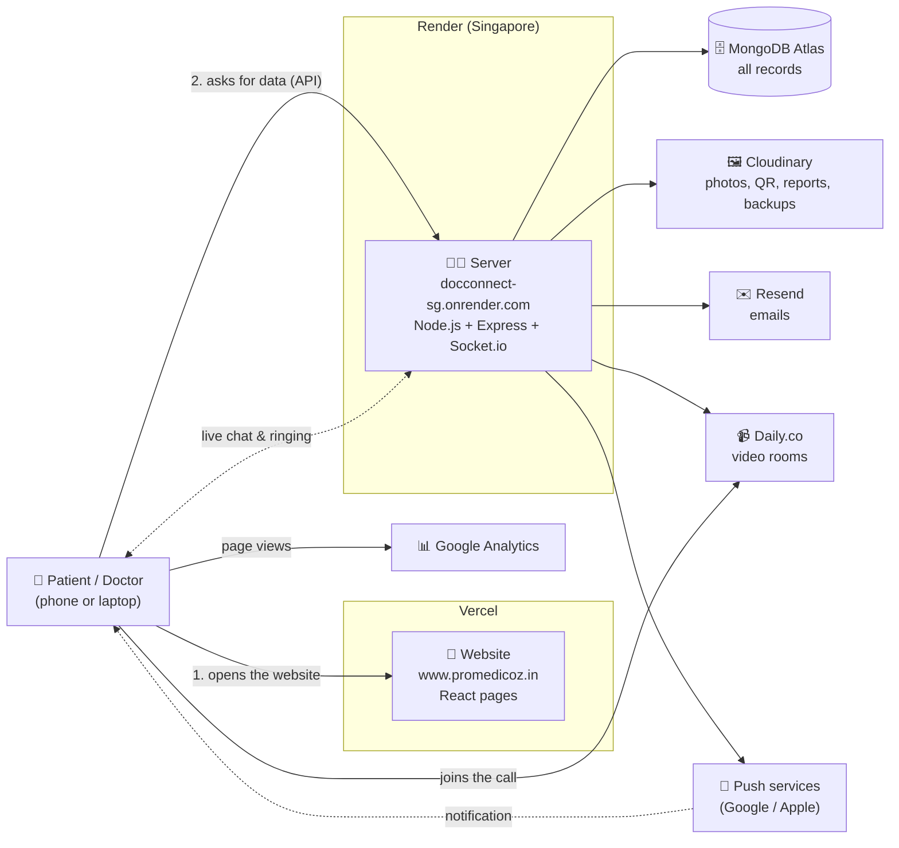
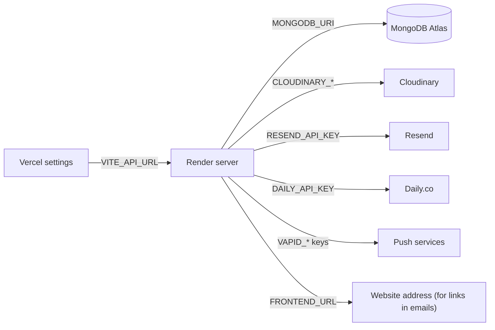
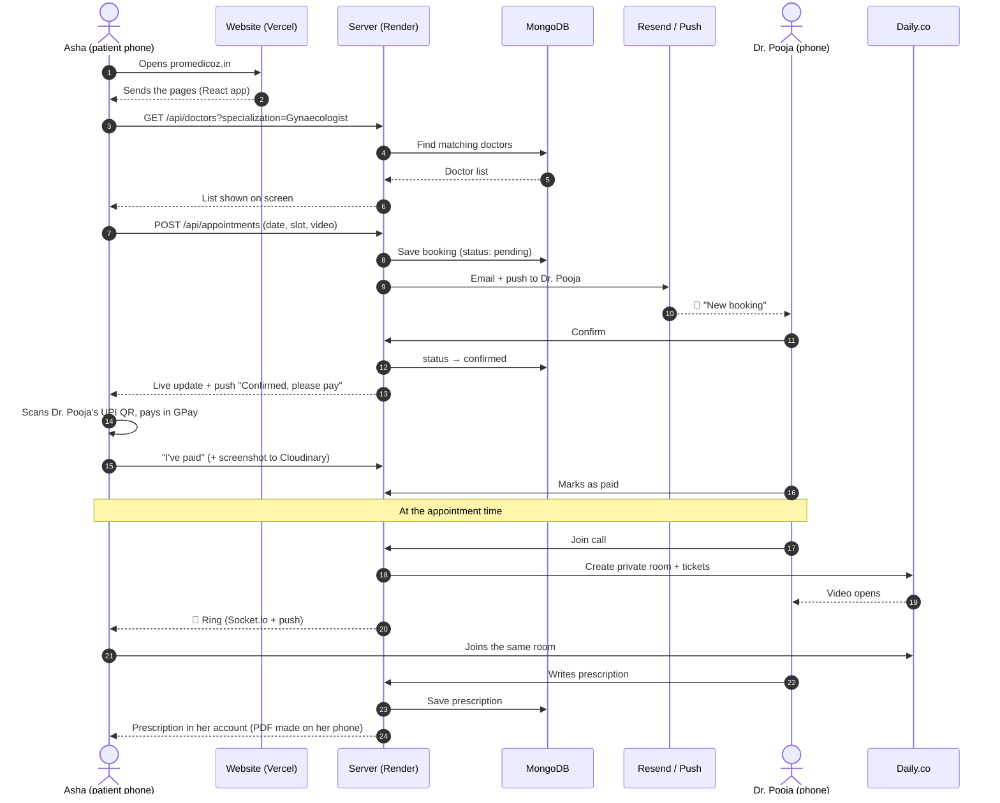
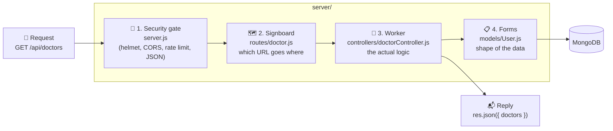
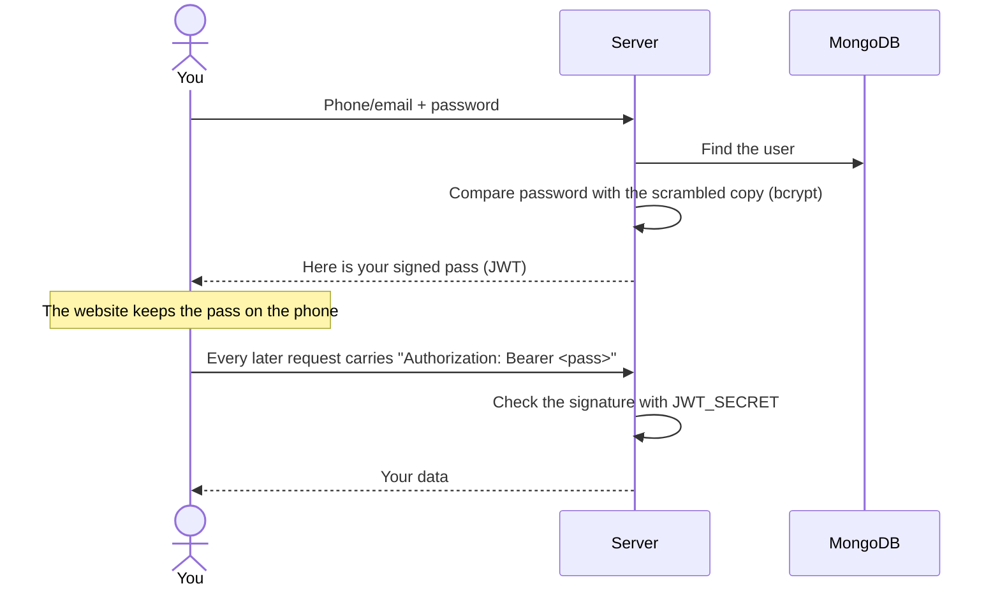
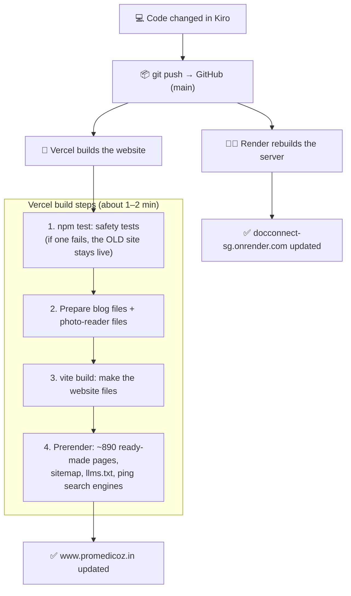

# Learn How ProMedicoz Connects: A Guided Tour

> **Who this is for:** you, the owner, learning how the app works.
> **How to read it:** top to bottom, one chapter at a time. Each chapter ends with a small **"Try it"** you can do in your browser. Nothing in this guide can break the live site.
>
> For deeper detail later: `README.md` (setup and every API URL) and `HOW_IT_WORKS.md` (every feature, in depth).

---

## Contents

1. [The big picture: ProMedicoz is a hospital](#1-the-big-picture-promedicoz-is-a-hospital)
2. [Meet the 12 helpers (every service, one card each)](#2-meet-the-12-helpers)
3. [How they find each other: the address book](#3-how-they-find-each-other-the-address-book)
4. [Follow one booking from start to finish](#4-follow-one-booking-from-start-to-finish)
5. [Inside the server: the four-room building](#5-inside-the-server-the-four-room-building)
6. [Login: how the server knows it's you](#6-login-how-the-server-knows-its-you)
7. [Real-time: how the doctor's phone rings](#7-real-time-how-the-doctors-phone-rings)
8. [The night shift: jobs that run by themselves](#8-the-night-shift-jobs-that-run-by-themselves)
9. [From your laptop to the live site](#9-from-your-laptop-to-the-live-site)
10. [How Google sees ProMedicoz](#10-how-google-sees-promedicoz)
11. [What breaks if a service goes down](#11-what-breaks-if-a-service-goes-down)
12. [Things that happen only on the patient's phone](#12-things-that-happen-only-on-the-patients-phone)
13. [Your learning path (files to read, in order)](#13-your-learning-path)
14. [Quiz yourself](#14-quiz-yourself)
15. [Glossary in plain words](#15-glossary-in-plain-words)

---

## 1. The big picture: ProMedicoz is a hospital

Think of ProMedicoz as a hospital building. Every part of the app has a job you already know from a real hospital:

| In a hospital | In ProMedicoz | Service |
|---|---|---|
| 🏥 The reception hall: what visitors see | The website and its pages | **Vercel** (React website) |
| 👩‍⚕️ The staff behind the counter who do the work | The server: login, booking, payments, rules | **Render** (Node.js + Express) |
| 🗄️ The records room | The database: every user, booking, prescription | **MongoDB Atlas** |
| 🖼️ The X-ray and photo store | Doctor photos, UPI QR codes, reports, backups | **Cloudinary** |
| ✉️ The post office | Emails: verify email, reset password, alerts | **Resend** |
| 📹 The consultation room with a camera | Video and phone calls | **Daily.co** |
| 🔔 The hospital pager | Notifications on the phone | **Web Push** |
| 📞 The internal intercom | Live chat, "doctor is calling" ringing | **Socket.io** |
| 📦 The building's blueprint office | All the code, and the uptime watchman | **GitHub** |
| 📊 The visitor counter at the gate | Which pages people visit, which buttons they tap | **Google Analytics** |
| 🪧 The signboard on the highway | How people find you on Google | **Google Search Console / Bing / IndexNow** |
| 💬 The phone at the help desk | "WhatsApp us" buttons | **WhatsApp links** (no paid service) |

### The picture

**The one rule to remember:** the phone talks to **two** places. It gets the *pages* from Vercel, and the *data* from Render. Render is the only one that talks to the database and the other services.

> **Try it:** open https://docconnect-sg.onrender.com/api/health in your browser. You'll see something like `{"status":"OK","database":"Connected"}`. You just asked the server (Render) how it's doing, and it checked the records room (MongoDB) for you.

---

## 2. Meet the 12 helpers

Each card says what the service is, what ProMedicoz uses it for, where its settings live, and where to look in the code.

### 🏥 Vercel: the website host
- **What it is:** a company that stores the website files and sends them to every visitor, fast, from servers near them.
- **Used for:** the website at **www.promedicoz.in**: every page, button and picture you see.
- **Settings:** Vercel dashboard → the project (its root folder is `client/`). One setting matters most: `VITE_API_URL`, the server's address.
- **Code:** everything in `client/`. The rules for Vercel are in `client/vercel.json`.

### 👩‍⚕️ Render: the server host
- **What it is:** a company that runs our server program 24/7.
- **Used for:** the server at **docconnect-sg.onrender.com** (in Singapore, close to India). It handles login, doctors, bookings, payments, chat and prescriptions.
- **Settings:** Render dashboard → **docconnect-sg** → Environment. All the secret keys live here (see chapter 3).
- **Code:** everything in `server/`. It starts at `server/server.js`.

### 🗄️ MongoDB Atlas: the database
- **What it is:** MongoDB's own cloud service. It stores data as "documents" (like filled-in forms) in "collections" (like folders).
- **Used for:** users (patients, doctors, admins), appointments, prescriptions, reports, reviews, messages, complaints, family members and more.
- **Settings:** Atlas dashboard → the cluster. **Network Access** lists which servers may connect (Render's addresses).
- **Code:** the shape of each record is in `server/models/` (for example `User.js`, `Appointment.js`). The code talks to it through **Mongoose**.

### 🖼️ Cloudinary: the photo store
- **What it is:** a service that stores images and files and can resize them on the fly.
- **Used for:** doctor profile photos, UPI QR codes, payment screenshots, medical reports, and the encrypted nightly **database backups**.
- **Code:** `server/utils/uploadFile.js` (uploads), `server/utils/backup.js` (backups). On the website, `getUploadUrl()` in `client/src/services/api.js` builds the picture links.

### ✉️ Resend: the post office
- **What it is:** an email-sending service (the free plan allows 100 emails a day).
- **Used for:** email verification, password reset, booking emails to doctors, and admin alerts ("new doctor joined", "database down").
- **Code:** `server/utils/sendEmail.js`.

### 📹 Daily.co: the video room
- **What it is:** a video-call service that the app opens inside the page.
- **Used for:** video and phone consultations. The server creates a **private room per appointment** and a short-lived "entry ticket" (token) for the doctor and patient, so nobody needs to log in to Daily.
- **Code:** `server/utils/daily.js` (rooms and tickets), and `getVideoToken` in `server/controllers/appointmentController.js`.

### 🔔 Web Push: the pager
- **What it is:** a feature built into browsers. Our server sends a message to Google's or Apple's push service, which delivers it to the phone, even when the site is closed.
- **Used for:** "Doctor confirmed your booking", "New booking", "Doctor is calling you".
- **Settings:** three `VAPID_...` keys on Render (they prove the message really comes from ProMedicoz).
- **Code:** `server/utils/push.js` (sending), `client/src/services/push.js` (asking permission), `client/public/sw.js` (the "service worker" that shows the notification).

### 📞 Socket.io: the intercom
- **What it is:** a live, always-open line between the phone and the server, instead of asking again and again.
- **Used for:** chat messages appearing instantly, the incoming-call ring, and booking pages updating by themselves.
- **Code:** `server/socket.js` and `client/src/services/socket.js`. It runs **inside** our Render server, so it isn't a separate company.

### 📦 GitHub: the blueprint office and watchman
- **What it is:** where all the code is stored, with full history.
- **Used for:** the repo `kndnkmr/docconnect`. Every push to `main` makes Vercel and Render rebuild automatically. GitHub Actions also runs an **uptime check every ~10 minutes** and emails you if the site or database is down.
- **Code:** `.github/workflows/uptime.yml`.

### 📊 Google Analytics: the visitor counter
- **What it is:** counts page visits and button taps, anonymously.
- **Used for:** learning what works, for example `find_doctor_click` or `tool_kundli_share_family`. Health details are never sent.
- **Code:** `client/src/components/Analytics.jsx` (`trackEvent(...)`).

### 🪧 Google Search Console, Bing, IndexNow: the highway signs
- **What they are:** tools that tell search engines your pages exist.
- **Used for:** the sitemap, ownership checks (meta tags in `client/index.html`, never delete them), and pinging Bing about new pages after each deploy.
- **Code:** `client/scripts/prerender.mjs` (see chapter 10).

### 💬 WhatsApp links: the help-desk phone
- **What it is:** plain `https://wa.me/...` links. They open WhatsApp with a message already typed. There's no WhatsApp API and no cost.
- **Used for:** "WhatsApp us", "Notify me", sharing articles and tools.

> **Money note:** payments do **not** go through any payment company. The patient pays the doctor directly by UPI (scanning the doctor's QR). ProMedicoz never touches the money.

> **Try it:** on any ProMedicoz page, right-click a doctor's photo → "Open image in new tab". The address starts with `res.cloudinary.com`, so you're looking at the photo store directly.

---

## 3. How they find each other: the address book

Services don't "know" each other. Each one is given **addresses and keys** in its settings. These settings are called **environment variables**. They're kept on the hosting dashboards, not in the code, so secrets never end up on GitHub.

| Lives on | Name | What it means (no secret values here) |
|---|---|---|
| Vercel | `VITE_API_URL` | "The server is at `https://docconnect-sg.onrender.com/api`" |
| Vercel | `VITE_GA_MEASUREMENT_ID` | Which Google Analytics account to count visits in |
| Vercel | `VITE_WHATSAPP_NUMBER` | Support WhatsApp number for the "WhatsApp us" buttons |
| Render | `MONGODB_URI` | The database link, with username and password |
| Render | `JWT_SECRET` | The secret used to sign login passes (chapter 6) |
| Render | `CLOUDINARY_CLOUD_NAME`, `_API_KEY`, `_API_SECRET` | Photo store login |
| Render | `RESEND_API_KEY`, `FROM_EMAIL` | Email sending login and the "from" address |
| Render | `DAILY_API_KEY`, `DAILY_DOMAIN` | Video service login |
| Render | `VAPID_PUBLIC_KEY`, `VAPID_PRIVATE_KEY`, `VAPID_SUBJECT` | Push notification identity |
| Render | `FRONTEND_URL` | The website address, used in email links and security checks |
| Render | `ADMIN_EMAIL`, `ADMIN_NOTIFY_EMAIL` | Where admin alerts go |
| Render | `BACKUP_KEY` | The lock for backups. **Keep it in your password manager; without it, backups can't be opened** |
| Render | `NODE_ENV` | `production`: hide technical error details from users |

**Why the `VITE_` names?** Settings for the website must start with `VITE_`, because they get baked into the website files, which anyone can read. That's why no secret ever starts with `VITE_`. All secrets live on Render.

> **Try it:** open `server/server.js` and search for `process.env.MONGODB_URI`. That one line is where the server reads the database address from its settings.

---

## 4. Follow one booking from start to finish

Let's follow **Asha** booking a video consultation with **Dr. Pooja**, and watch every service do its part.

**The same story in words, with the files involved:**

| Step | What Asha sees | What happens behind | Where in the code |
|---|---|---|---|
| 1 | Home page loads | Vercel sends the React website | `client/src/pages/Home.jsx` |
| 2 | List of gynaecologists | Website calls the server, and the server asks MongoDB | `client/src/services/api.js` → `server/routes/doctor.js` → `server/controllers/doctorController.js` |
| 3 | Picks a slot, taps Book | Server checks the slot is free and saves the booking. The database itself refuses double bookings | `server/utils/booking.js`, `server/models/Appointment.js` |
| 4 | "Waiting for doctor" | Email (Resend) and push (Web Push) go to Dr. Pooja | `server/utils/sendEmail.js`, `server/utils/push.js` |
| 5 | "Confirmed! Pay now" | Doctor confirms; the page updates live through Socket.io | `client/src/pages/BookingConfirmation.jsx` |
| 6 | QR code + "I've paid" | QR image comes from Cloudinary. Money goes straight from Asha's UPI app to the doctor | `client/src/components/PaymentBox.jsx` |
| 7 | Phone rings at call time | Server creates a Daily.co room and rings Asha | `server/utils/daily.js`, `server/socket.js` |
| 8 | Prescription appears | Saved in MongoDB; the PDF is made on Asha's phone | `server/models/Prescription.js`, `client/src/utils/prescriptionPdf.js` |
| 9 | "Rate your visit" | A background job asks for a review later | `server/utils/reviewRequest.js` |

> **Try it:** open www.promedicoz.in/doctors on a laptop, press **F12** (or right-click → Inspect), and choose the **Network** tab. Reload the page. Look for a line called `doctors?...`, which is the website asking the server for data. Click it, then **Response**, and you'll see the actual doctor list the server sent.

---

## 5. Inside the server: the four-room building

Every request to the server walks through four rooms, always in this order:

| Room | Folder | Its job | Example |
|---|---|---|---|
| 🚪 Security gate | `server/server.js` | Checks every visitor: blocks attacks, limits too many requests, reads the data sent | `app.use(helmet())` |
| 🗺️ Signboard | `server/routes/` | Points each URL to the right worker, and checks login first where needed | `router.put('/profile', protect, authorize('doctor'), ...)` |
| 🧠 Worker | `server/controllers/` | Does the job: find, check, save, notify | `getAllDoctors` finds and sorts doctors |
| 📋 Forms | `server/models/` | Defines what a record looks like and checks it | `consultationFee: Number` |
| 🧰 Toolbox | `server/utils/` | Shared helpers used by many workers | sending email, push, booking rules |
| 🛂 Guards | `server/middleware/` | "Are you logged in?", "Are you a doctor?", file uploads | `middleware/auth.js` |

> **Try it:** open `server/routes/doctor.js` next to `server/controllers/doctorController.js`. Find `getAllDoctors` in both. The route says *which URL*, the controller says *what to do*.

---

## 6. Login: how the server knows it's you

The server can't see your face, so it gives you a **signed pass** (a "JWT") when you log in, like a hospital visitor badge.

- **Passwords are never stored as typed.** They're scrambled with **bcrypt**, so even the database owner can't read them.
- **The pass is signed** with `JWT_SECRET`, which only the server knows. If anyone changes the pass, the signature breaks and the server rejects it.
- **Changing your password logs out other devices,** because the server checks `passwordChangedAt`.
- **Roles:** the pass says whether you're a `patient`, `doctor` or `admin`, and `authorize('doctor')` checks it.

**Code:** `server/controllers/authController.js` (login), `server/middleware/auth.js` (checking the pass), `client/src/context/AuthContext.jsx` (keeping it on the phone), and `client/src/services/api.js` (adding it to every request).

---

## 7. Real-time: how the doctor's phone rings

ProMedicoz uses **two** ways to reach a phone, because each covers what the other can't:

| | 📞 Socket.io (intercom) | 🔔 Web Push (pager) |
|---|---|---|
| Works when | The website is **open** | The website is **closed**, even with the phone locked |
| Speed | Instant | A few seconds |
| Used for | Chat messages, live booking page, ringing screen | "New booking", "Confirmed", "Doctor is calling" |
| Needs | Nothing | The user to tap **Allow notifications** once. On iPhone, ProMedicoz must be added to the Home Screen first |

When the doctor taps **Call**, the server does both at once: it sends `incoming-call` over Socket.io, so the patient's open screen rings, **and** sends a push, so a closed or locked phone rings too.

**Code:** `server/socket.js`, `server/utils/push.js`, `client/public/sw.js`, and `setCallStatus` in `server/controllers/appointmentController.js` (it sends both the ring and the push).

---

## 8. The night shift: jobs that run by themselves

There's no separate scheduling service. The server sets **timers** when it starts (`setInterval` in `server/server.js`), and each timer runs a small job:

| Every | Job | What it does | File |
|---|---|---|---|
| 20 seconds | Call start reminder | Rings the doctor when a call time arrives | `utils/callReminder.js` |
| 1 minute | Appointment reminders | "Your appointment is soon" | `utils/appointmentReminder.js` |
| 1 minute | Review requests | A few hours after a completed visit, asks the patient to rate it | `utils/reviewRequest.js` |
| 10 minutes | Attendance | Marks visits complete, asks "Did the patient come?" | `utils/attendance.js` |
| 10 minutes | Payment follow-up | Gentle reminder if a confirmed booking isn't paid | `utils/paymentFollowUp.js` |
| 10 minutes | Journey reminders | Nudges people stuck mid-way | `utils/journeyReminders.js` |
| 10 minutes | Admin digests | Daily summary of admin edits, and the 7 PM new-patients email | `utils/adminEditNotes.js`, `utils/signupAlerts.js` |
| 10 minutes (checks the clock) | Nightly backup | ~2:30 AM IST encrypted copy of the database → Cloudinary | `utils/backup.js` |
| 24 hours | Account clean-up | Permanently removes accounts deleted long ago | `utils/accountCleanup.js` |

And watching over everything:
- **GitHub Actions** checks the website and server every ~10 minutes and emails you if they're down (`.github/workflows/uptime.yml`).
- **The server watches itself**, and emails you if the database disconnects or errors pile up (`server/utils/healthWatch.js`).

---

## 9. From your laptop to the live site

Key ideas:
- **There's no "deploy" button.** Pushing to GitHub *is* the deploy.
- **Tests are the safety net.** The website build runs about 200 tests first, and if any fails, nothing new goes live.
- **The two halves update separately.** For a minute or two, the new website may talk to the old server (or the reverse). That's why changes are made so the old and new versions work together.

---

## 10. How Google sees ProMedicoz

A React website is built in the browser by JavaScript. Google and WhatsApp prefer pages that are **already written out**. So during every build, `client/scripts/prerender.mjs` writes a ready-made page for each important address:

| Pages | How many | Why |
|---|---|---|
| Blog articles (English + Hinglish) | ~790 | So searches like "periods late reasons" find us |
| Doctor pages `/dr/...` | one per doctor | "Dr. Pooja Singh gynaecologist Bhilai" |
| Specialty and city pages | dozens | "best gynaecologist in Bhilai" |
| Free tools (Sehat Kundli, Report Samjhao, …) | 2 each (EN + HI) | "baby vaccine chart Hindi" |

Each ready-made page carries:
- **Title and description:** what Google shows in results.
- **Share card (`og:image`):** the picture WhatsApp shows when someone shares a link.
- **Readable text:** a hidden copy of the content for crawlers. It's replaced by the real page the moment the app starts.
- **Structured data (JSON-LD):** "this is an article, written in Hindi, by ProMedicoz".

Plus a **sitemap** (the list of all pages), and **IndexNow** (a ping to Bing after each deploy).

> **Try it:** open https://www.promedicoz.in/tools/sehat-kundli, right-click → **View page source**, and search for `og:image`. That's the picture WhatsApp shows when someone shares the link.

---

## 11. What breaks if a service goes down

Use this when something goes wrong. It shows what users would notice, and where to look first.

| If this is down… | Users notice | Still works | First place to check |
|---|---|---|---|
| 🏥 Vercel | Website doesn't open at all | Nothing for users | Vercel dashboard → Deployments |
| 👩‍⚕️ Render | Pages open, but no doctors, no login, no booking | Blog articles and free tools (they need no server) | Render → docconnect-sg → Logs |
| 🗄️ MongoDB Atlas | Server says "database Disconnected"; nothing loads data | Blog and tools | Atlas → cluster status, Network Access |
| 🖼️ Cloudinary | Doctor photos and QR codes missing; uploads fail | Booking without photos | Cloudinary status page |
| ✉️ Resend | No emails (password reset by email fails) | Everything else, and push still works | Resend dashboard; 100/day limit |
| 📹 Daily.co | Video and phone calls don't start | Booking, chat, payment | Daily.co dashboard |
| 🔔 Push services | Phones don't get notifications | Everything on an open screen | Rare; usually permission was turned off on that phone |
| 📦 GitHub | You can't push new code | **The live site keeps running** | GitHub status page |

**You'll usually hear about problems before users tell you:** from the GitHub uptime email, or the server's own "database down" email.

---

## 12. Things that happen only on the patient's phone

Some features don't use any server at all, by design, for privacy. The data never leaves the phone:

| Feature | How it works on the phone |
|---|---|
| 🪔 Sehat Kundli | Rules run in the browser. The "send to siblings" link carries the family list after `#`, which browsers never send to servers |
| 🧪 Report Samjhao | Photo text is read **on the phone** (Tesseract); nothing is uploaded |
| 🤰 Due date, 🌷 ovulation, 💉 vaccine tools | Pure date maths in the browser |
| 🎤 Voice search | The phone's built-in speech recognition (Web Speech API) |
| 📄 Prescription PDF, clinic poster | Made on the phone (jsPDF) |
| 💳 Reading the UPI ID from a QR | On the phone (jsQR) |
| 📲 App install, offline cache | Service worker `client/public/sw.js` |

This is why those pages keep working even if the server is down, and why ProMedicoz can honestly say "your details stay on your phone".

---

## 13. Your learning path

Read in this order. Each file is short-ish and has plain-English comments. Tick them off as you go.

**Week 1: the big picture**
- [ ] This guide, chapters 1–4
- [ ] `client/src/App.jsx`: every page address (route) of the website
- [ ] `server/server.js`: how the server starts and plugs everything in

**Week 2: follow the data**
- [ ] `client/src/services/api.js`: every call the website makes to the server
- [ ] `server/routes/doctor.js` + `server/controllers/doctorController.js`: one full request
- [ ] `server/models/Appointment.js`: what a booking looks like in the database

**Week 3: people and safety**
- [ ] `server/middleware/auth.js`: checking the login pass
- [ ] `server/utils/booking.js`: the booking rules (no double booking)
- [ ] `client/src/components/PaymentBox.jsx`: the payment step patients see

**Week 4: the extras**
- [ ] `server/socket.js` + `server/utils/push.js`: live updates and notifications
- [ ] `client/src/pages/tools/kundliRules.js`: a whole feature with no server at all
- [ ] `client/scripts/prerender.mjs` (skim it): how Google sees the site

**Free learning resources** (in the same order as the tech):
- JavaScript basics: https://javascript.info
- React: https://react.dev/learn
- Express: https://expressjs.com/en/starter/hello-world.html
- MongoDB basics: https://learn.mongodb.com (free courses)

---

## 14. Quiz yourself

Answers are hidden; tap to reveal.

<b>1. A patient opens the website. Which two places does their phone talk to?</b>

Vercel (for the pages) and Render (for the data). Only Render talks to the database.

<b>2. Where is the database password kept?</b>

In Render's Environment settings, as `MONGODB_URI`. It's never in the code or on GitHub.

<b>3. Render is down. Can someone still read a blog article?</b>

Yes. Articles are ready-made pages on Vercel, and their text is bundled with the website. Doctor lists and booking won't work, though.

<b>4. Why does a doctor get a ring even when their phone is locked?</b>

Because the server sends a Web Push notification as well as the Socket.io message. Push is delivered by Google's or Apple's push service even when the site is closed.

<b>5. Who holds the patient's payment money?</b>

Nobody in between. The patient pays the doctor directly by UPI; ProMedicoz never touches it.

<b>6. You pushed code and one test failed. What do users see?</b>

The old website, unchanged. The build stops, so nothing broken goes live.

<b>7. What is the folder where "what to do" logic lives on the server?</b>

`server/controllers/`. Routes decide *which URL*, controllers decide *what to do*, and models describe *what the data looks like*.

<b>8. Why can't secrets start with VITE_?</b>

`VITE_` settings get baked into the website files, which anyone can read. Secrets must stay on the server (Render).

---

## 15. Glossary in plain words

| Word | Plain meaning |
|---|---|
| **Frontend** | The part people see and tap: the website (`client/`) |
| **Backend / server** | The part that does the work out of sight (`server/`) |
| **API** | The server's "menu" of requests it understands, like `GET /api/doctors` |
| **Endpoint / route** | One item on that menu: one address plus an action |
| **Request / response** | The question the phone asks, and the answer the server sends |
| **JSON** | The text format used to send data: `{"name": "Dr. Pooja"}` |
| **Database / collection / document** | Records room / one folder (e.g. appointments) / one filled-in form |
| **Mongoose model** | The template for a form: which fields, which types |
| **Middleware** | A checkpoint every request passes through (security, login check) |
| **Environment variable** | A setting kept on the host, not in the code, often a secret |
| **JWT** | The signed login pass the phone shows on every request |
| **bcrypt** | The scrambler that makes stored passwords unreadable |
| **Socket.io** | An always-open live line between phone and server |
| **Web Push / VAPID** | Phone notifications / the keys that prove they're from us |
| **Service worker** | A small background script in the browser: notifications, offline, install |
| **PWA** | A website that can be installed like an app |
| **React component** | A reusable piece of screen, like `PaymentBox` |
| **Build** | Turning our code into fast files the browser can load |
| **Prerender** | Writing ready-made pages at build time, for Google and WhatsApp |
| **Deploy** | Putting a new version live (here: automatic on `git push`) |
| **Repo / commit / push** | The code store / a saved change / sending saved changes to GitHub |
| **CORS** | The rule that only our website may call our server from a browser |
| **Rate limit** | Blocking someone who sends too many requests too fast |
